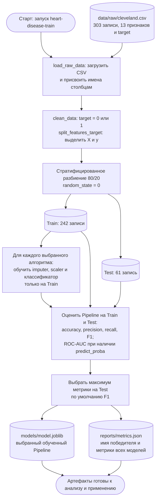
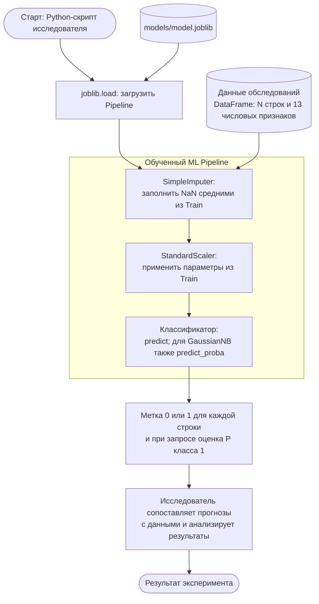

# Место ML-модели в процессе проекта

Проект решает задачу бинарной классификации наличия болезни сердца
по данным обследования. В текущей реализации модель находится в техническом
процессе **подготовки данных → обучения и сравнения → сохранения Pipeline →
получения прогнозов → анализа результатов**.
По опубликованным результатам лучшая модель по F1 — Gaussian Naive Bayes.
Подробные данные о ней приведены в [Model Card](model_card.md).

Ниже используются диаграммы Mermaid, которые GitHub отображает прямо
в Markdown. Это схемы технического процесса с этапами и потоками данных;
они не являются исполняемыми BPMN 2.0-моделями.

## 1. Обучение и выбор модели — реализованный процесс

Реализация: [data.py](src/heart_disease/data.py),
[models.py](src/heart_disease/models.py),
[evaluate.py](src/heart_disease/evaluate.py),
[train.py](src/heart_disease/train.py).

По умолчанию сравниваются семь алгоритмов; их набор и критерий выбора
можно изменить параметрами CLI. Пропуски заполняются средними, затем признаки
масштабируются. Параметры обоих преобразований вычисляются на Train и вместе
с классификатором сохраняются в Pipeline.

**Особенность оценки:** выбор победителя производится на том же Test,
для которого публикуются метрики. Отдельного независимого итогового теста
и автоматического порога допуска к эксплуатации в коде нет.
Артефакты генерируются локально и исключены из Git; в текущей копии
они отсутствуют. Приведённые в Model Card значения взяты из README.

## 2. Применение сохранённой модели

Применение через `joblib.load` и `pipeline.predict` показано в
[README](README.md#быстрый-старт). При инференсе передаются только признаки;
`target` нужен для обучения и проверки качества. Для новых записей пользователь
формирует DataFrame с именами и порядком столбцов из `FEATURE_COLUMNS`,
согласованными единицами измерения и числовыми кодами категорий.
`NaN` обрабатывает Pipeline; текстовые маркеры пропусков нужно предварительно
привести к `NaN`. Автоматическая проверка клинических диапазонов не реализована.

Получение прогноза реализовано средствами Pipeline; анализ исследователем
на схеме — внешний ручной шаг. Отдельного сервиса прогнозирования,
клинического интерфейса или автоматического назначения действий в проекте нет.

## 3. Краткое описание роли модели

| Вопрос | Ответ |
| --- | --- |
| Какую задачу решает модель? | Сопоставляет совокупность признаков обследования с бинарной меткой наличия болезни сердца по разметке Cleveland. В техническом процессе превращает подготовленную строку признаков в прогноз. |
| Почему целесообразно использовать ML? | Есть размеченные исторические примеры, на которых можно обучить и количественно сравнить классификаторы. ML позволяет совместно учитывать 13 признаков и их статистическую связь с целью, не задавая вручную правила для всех сочетаний. Простая GaussianNB подходит как недорогая по вычислениям исследовательская модель; её преимущество для реальной клинической практики отдельно не доказано. |
| Какие данные поступают на вход? | Возраст, пол, тип боли в груди, давление в покое, холестерин, признак повышенной глюкозы натощак, ЭКГ в покое, максимальная ЧСС, стенокардия при нагрузке, депрессия ST, наклон ST, число визуализированных сосудов и код результата исследования `thal`. Полная схема и единицы — в Model Card. |
| Как используется результат дальше? | При обучении прогнозы сравниваются с известной целью для расчёта метрик и выбора Pipeline. При применении возвращаются метки `0/1` и, для GaussianNB при запросе, вероятностные оценки; исследователь использует их для анализа записей и проверки гипотез. |

Модель оценивает наличие болезни в терминах учебного датасета.
Результат `0` не является основанием отменять обследование, а результат `1`
не является самостоятельным диагнозом. Вероятностные оценки не прошли
отдельную калибровку.

Возможное дальнейшее включение в процесс поддержки врача потребует
независимой клинической валидации и врачебной проверки результатов.
Такой процесс не реализован в текущем проекте. Особенно важно проверить,
доступны ли все 13 признаков в момент предполагаемого применения:
часть из них получается при нагрузочных и инструментальных исследованиях.

## 4. Соответствие схемы артефактам проекта

| Элемент процесса | Место в репозитории / результат |
| --- | --- |
| Схема входных данных и параметры разбиения | [config.py](src/heart_disease/config.py) |
| Чтение CSV и бинаризация цели | [data.py](src/heart_disease/data.py) |
| Реестр алгоритмов и Pipeline | [models.py](src/heart_disease/models.py) |
| Вычисление метрик | [evaluate.py](src/heart_disease/evaluate.py) |
| Обучение, выбор и сохранение | [train.py](src/heart_disease/train.py) |
| Сохранённая модель | `models/model.joblib`, создаётся командой `poetry run heart-disease-train` |
| Отчёт о сравнении | `reports/metrics.json`, создаётся той же командой |
| Назначение, характеристики и ограничения | [model_card.md](model_card.md) |
