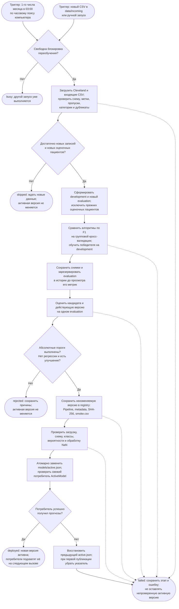

# Автоматическое переобучение: реализованный локальный процесс

В проект добавлена программная реализация: команда `heart-disease-retrain`
получает новые размеченные CSV, обучает и оценивает кандидата, сохраняет
одобренную версию в реестре и атомарно активирует её для Python-прогнозов.
Планировщик macOS запускает эту команду автоматически после установки
LaunchAgent. Внешний сервер для этого локального контура не требуется.

Назначение модели — бинарная классификация наличия болезни сердца
по 13 признакам Cleveland; ограничения приведены в [Model Card](model_card.md).
Пороги допуска ниже являются параметрами учебного контура и не подтверждают
пригодность для самостоятельных медицинских решений.

## 1. Схема процесса

Схема Mermaid отображается непосредственно в Markdown на GitHub.



## 2. Основные этапы и передаваемые результаты

| Этап | Что выполняется | Результат следующему этапу |
| --- | --- | --- |
| Триггер | LaunchAgent запускает процесс ежемесячно, при изменении входящего каталога и после загрузки агента; возможен ручной запуск. Межпроцессная блокировка исключает одновременные выпуски и откаты. | `run_id`, причина запуска, эксклюзивная блокировка. |
| Получение данных | Читаются `data/raw/cleveland.csv` и все завершённые `data/incoming/*.csv`. Каждый файл читается один раз; SHA-256 вычисляется по тем же байтам. | Объединённая таблица и manifest исходных файлов. |
| Проверка и подготовка | Проверяются столбцы, числовые типы, конечность значений, категории, цель `0–4`, доля пропусков и согласованность дубликатов. Затем цель бинаризуется. | Допущенная таблица признаков, цели и идентификаторов либо `failed`. |
| Независимое разбиение | Из новых пациентов выделяется evaluation; остальные доступные записи образуют development. Все ранее оценочные пациенты навсегда исключаются из обучения. | Снимки `development.csv`, `evaluation.csv` и сохранённая история происхождения разбиений. |
| Обучение | Семь алгоритмов сравниваются по средней F1 на `StratifiedGroupKFold`. Imputer и scaler обучаются внутри каждого fold. Победитель повторно обучается только на development. | `candidate.joblib`, имя алгоритма и CV-метрики. |
| Проверка качества | Кандидат и действующая версия оцениваются на одном новом evaluation. Метрики вычисляются без округления, сохраняется матрица ошибок. | Метрики кандидата и действующей модели, решение шлюза. |
| Решение о выпуске | Проверяются абсолютные пороги, отсутствие ухудшения и минимальное улучшение. Для первой версии сравнение с действующей моделью пропускается. | Допуск либо `rejected` с причинами; непрошедший кандидат остаётся в каталоге запуска. |
| Регистрация и staging | В реестр записываются Pipeline, метаданные и контрольный вход. Проверяются SHA-256, повторная загрузка и прогнозы, включая вход с NaN. | Отдельная неизменяемая версия, готовая к активации. |
| Деплой | Атомарно заменяется указатель `active.json`, затем свежий `ActiveModel` выполняет контрольный прогноз. Потребители проверяют указатель на каждом вызове. | Активная версия; новые вызовы автоматически загружают её. |
| Сбой активации | Восстанавливается прежний указатель. Если прежней версии нет, активный указатель удаляется и прогнозирование остаётся недоступным. | Предыдущее состояние и отчёт `failed`; также предусмотрена команда явного отката. |

## 3. Условия обучения и допуска

Настройки хранятся в [retraining.toml](retraining.toml), проверяются при загрузке
и записываются в отчёт запуска. Значения по умолчанию:

- Не менее **100 новых уникальных размеченных записей** относительно уже
  обработанных запусков. При первом запуске новыми считаются записи Cleveland.
- Около **20% новых пациентов** выделяются в evaluation. В нём требуется
  минимум **10 записей каждого класса**; в development должно быть достаточно
  групп обоих классов для **пяти fold**. Все fold проверяются на наличие
  обоих классов. При нехватке данных результат — `skipped`.
- Не более **5% пропусков** каждого признака в каждом исходном файле.
  `NaN` допускаются и далее обрабатываются Pipeline; бесконечности,
  нечисловые значения и некорректные метки блокируют запуск.
- На независимом evaluation: **recall ≥ 0.90**, **precision ≥ 0.80**,
  **F1 ≥ 0.85**. Все метрики должны быть конечными.
- При наличии действующей версии F1 и recall кандидата не должны ухудшиться;
  хотя бы одна из этих метрик должна вырасти на **0.01** или больше.
  Равное качество не приводит к замене модели.
- Pipeline должен успешно пройти сериализацию, проверку контрольной суммы,
  загрузку и smoke-проверку: одна метка `0/1` на строку, поддержка `NaN`,
  корректные вероятности при наличии `predict_proba`.

ROC-AUC сохраняется при наличии `predict_proba`; его отсутствие у SVM
в текущей конфигурации не блокирует выпуск. Алгоритм и порог классификации
не подбираются по evaluation. После получения его метрик данные считаются
обработанными даже при отказе в публикации: повторный запуск с теми же данными
не позволяет подбирать кандидатов до случайного прохождения проверки.
Прежние оценочные пациенты не используются и для будущих evaluation.

## 4. Формат и поступление новых данных

Входящие CSV имеют заголовок: `patient_id`, все 13 признаков
из [config.py](src/heart_disease/config.py) и `target`. Порядок столбцов
в исходном CSV может отличаться; перед обучением используется фиксированный
порядок `FEATURE_COLUMNS`. Пример формата одной строки:

```csv
patient_id,age,sex,cp,trestbps,chol,fbs,restecg,thalach,exang,oldpeak,slope,ca,thal,target
demo-patient-0001,52,0,2,125,211,0,0,164,0,0.5,1,0,3,0
```

`patient_id` — стабильный псевдоним пациента, одинаковый для всех его записей;
он не поступает в модель и в снимках заменяется SHA-256. Цель должна быть
подтверждённой меткой, а не предыдущим прогнозом. Одинаковые признаки
с конфликтующими метками или идентификаторами пациента отклоняются;
согласованные дубликаты удаляются.

Готовую порцию следует сначала записать с расширением `.part`, затем
атомарно переименовать в новый `.csv` внутри `data/incoming`. Старые порции
не удаляются: они составляют локальную историю обучения. Входящие файлы,
снимки, бинарные модели и журналы исключены из Git.

**Ограничение исходного Cleveland:** в нём нет идентификаторов пациентов.
Для первоначального учебного запуска каждая уникальная строка получает
идентификатор `legacy:<хеш признаков>`. Это обеспечивает разделение строк,
но не доказывает независимость реальных пациентов. Для новых данных
обязателен стабильный `patient_id`; скрытые совпадения с пациентами Cleveland
по одним признакам установить нельзя. Этот контур не является клинически
валидированным процессом.

## 5. Артефакты и использование активной версии

| Путь | Содержимое |
| --- | --- |
| `models/runs/<run_id>/report.json` | Причина запуска, настройки, версии кода и окружения, исходные SHA-256, размеры выборок, CV-метрики, независимая оценка и статус. |
| `models/runs/<run_id>/` | Снимки development / evaluation и Pipeline-кандидат, если обучение завершилось. |
| `models/history.json` | Обработанные записи, известные пациенты и все зарезервированные оценочные пациенты. Удалять файл для повторного использования evaluation нельзя. |
| `models/registry/<version>/` | `model.joblib`, `metadata.json` с SHA-256 модели и сведениями о коде / окружении, `smoke.csv`. Версия включает время UTC и уникальный суффикс. |
| `models/active.json` | Текущая и предыдущая версии. Это точка активации; файл заменяется атомарно на той же файловой системе. |
| `models/last_run.json`, `models/last_rollback.json` | Последний результат переобучения и последнего явного отката. |
| `ops/local/` | Сгенерированный LaunchAgent и журналы планировщика. |

`ActiveModel` из [registry.py](src/heart_disease/registry.py) проверяет
активную версию при каждом вызове и загружает новую при переключении.
Так деплой влияет на реальное прогнозирование, включая уже запущенный
Python-процесс. Отдельного сетевого API в проекте нет.

```python
from pathlib import Path
from heart_disease.registry import ActiveModel

model = ActiveModel(Path("models"))
predictions = model.predict(features)  # DataFrame с 13 столбцами FEATURE_COLUMNS
```

Пакетное применение и явный откат из корня проекта:

```bash
poetry run python -m heart_disease.predict --input features.csv --output predictions.csv
poetry run python -m heart_disease.retrain --rollback
```

При любой ошибке до активации действующая модель не меняется.
При ошибке контрольного потребителя после переключения указатель
восстанавливается автоматически. Долгосрочный мониторинг дрейфа
и автоматический откат по отложенным медицинским исходам не реализованы;
для явного отката доступна указанная команда.

## 6. Запуск и автоматическое расписание

```bash
poetry install
make check
make retrain
poetry run python -m heart_disease.launchd          # подготовить plist для проверки
poetry run python -m heart_disease.launchd --install # установить и загрузить LaunchAgent
```

LaunchAgent запускается в пользовательской сессии macOS: 1-го числа
месяца в 03:00 по системному часовому поясу (на этом компьютере — Москва),
при изменении входящего каталога и при загрузке агента. Частые события
ограничены интервалом 60 секунд; блокировка и история данных защищают
от параллельного и повторного обучения. Генерация plist сама по себе
не активирует расписание — нужен `--install`.
После переноса проекта или пересоздания виртуального окружения агент
нужно установить заново, чтобы обновить абсолютные пути.

`make clean` сохраняет реестр и историю разбиений: очистка кэшей
не должна позволять повторно обучать модель на оценочных пациентах.

Статусы: `deployed`, `rejected`, `skipped`, `busy`, `failed`.
Для `failed` CLI возвращает ненулевой код завершения и сохраняет этап ошибки.
Команда `heart-disease-train` сохранена как прежний экспериментальный CLI;
она не переключает `active.json` и не заменяет этот защищённый процесс.

Реализация: [retrain.py](src/heart_disease/retrain.py),
[retrain_data.py](src/heart_disease/retrain_data.py),
[retrain_settings.py](src/heart_disease/retrain_settings.py),
[registry.py](src/heart_disease/registry.py),
[launchd.py](src/heart_disease/launchd.py),
[predict.py](src/heart_disease/predict.py).
Сценарии допуска, отказа, утечек, конкуренции и отката проверяются
в [tests/test_retraining.py](tests/test_retraining.py).
